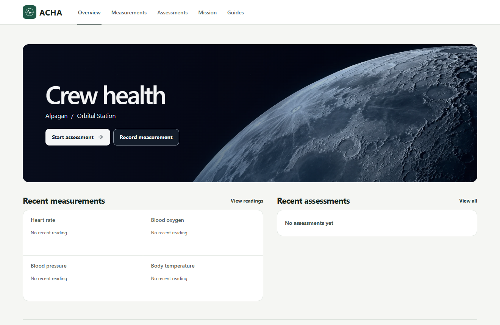

  

<h1 align="center">ACHA</h1>

  <strong>Autonomous Crew Health Assistant</strong> 
  Crew health check-ins for long duration space missions.

  <a href="https://acha.tr/">Open the Website</a> ·
  <a href="https://www.spaceappschallenge.org/2026/challenges/health-monitoring-software/">NASA Space Apps 2026</a>

  

When a crew is far from Earth, its members may need to assess health changes before a flight surgeon can respond. ACHA lets crew members record measurements, compare them with their own recent readings, and review findings and related training guides.

The web app records measurements and submits assessments through an API. The standalone onboard demo runs the assessment engine on a local workstation so the crew can complete a check-in during a simulated loss of contact with Earth.

**Try the browser scenario.** From Crew monitoring, select **Open synthetic scenario** and then **Open scenario check-in**. Review Alex’s recorded change and the incomplete measurement context. Record a repeat reading, link it in **Follow-up**, and close the check-in. The scenario saves fictional records in this browser. It works offline after the public app has loaded and cached its shell. **Return to mission service** switches back to the shared sample workspace.

## How a check-in works

1. **Choose a crew member.** A mission profile supplies equipment, constraints, and guidance for the current environment.
2. **Record a reading.** Save heart rate, respiratory rate, blood oxygen saturation, blood pressure, body temperature, or sleep duration. Each reading has a unit and a timestamp and stays in that crew member's history.
3. **Submit an assessment.** Select saved readings, report symptoms, or combine both. The engine evaluates the available inputs and reports missing information.
4. **Review the result.** Read the rationale and suggested next step, then open the training guide when one is linked. Previous assessments preserve the mission profile and inputs used at the time.
5. **Document follow up.** Link a later reading from the same crew member and record either continued review or workflow completion. Closing the check-in preserves the original result and repeat-reading history.

### How the engine evaluates a check-in

The web app applies symptom rules and checks supported vital signs against the NEWS2 reference. It saves the inputs, result, and rules used. When at least five earlier readings of the same kind are available for the same crew member, the app shows how the current reading differs from the median of those readings over the preceding 30 days. Blood pressure comparisons use systolic values. The comparison is descriptive.

The standalone demo covers the full terrestrial NEWS2 reference calculation in its test scenarios. The mission-service form displays incomplete scoring when required observations are missing. The browser-only scenario uses descriptive daily medians and provides no clinical score. The mission profiles and response mappings are training settings. [NEWS2 sources and scope](demo/NEWS2_SOURCES.md)

## Data and evidence

| Source | How ACHA uses it |
| --- | --- |
| Crew entries | The API stores entered measurements and symptoms in PostgreSQL. The seed provides a crew roster and mission profiles with empty histories. |
| PhysioNet BIDMC | The Research page parses 481 published hospital observations and calculates the medians. **Fetch from PhysioNet** downloads the original record and recalculates them. This dataset has its own research view. [Data source and attribution](demo/DATA_SOURCE.md) |
| NASA OSDR Rodent Research 6 | **Fetch from NASA** on the Research page loads historical ISS cabin temperature, relative humidity and ambient CO₂ from the public Environmental Data Application. [Source registry](docs/health-monitoring.md#scientific-source-registry) |
| NASA OSDR RadLab DosTel1 | **Fetch from RadLab** loads historical instrument dose rates from the ISS Columbus module. [Source registry](docs/health-monitoring.md#scientific-source-registry) |
| ACHA pressure scenario | **Mission → Review cabin pressure** shows a synthetic cabin timeline, measured-interval calculations, and comparison with a fictional resting baseline. The scenario runs offline after the app shell is cached. [Analysis method](docs/health-monitoring.md#pressure-analysis-and-interpretation) |
| Mission observations | **Mission → Mission observations** compares synthetic sleep, cognition, workload, physiology and environment. An optional restricted log supports manual measurements and clinical/operational events. [Restricted log setup](docs/health-monitoring.md#restricted-log-setup) |
| NASA Human Research Program | Spaceflight hazards and Earth-independent medical operations inform the choice of measurements and the onboard workflow. [NASA hazards](https://www.nasa.gov/hrp/hazards/) · [NASA risks](https://www.nasa.gov/hrp/risks/) · [NASA medical operations research](https://www.nasa.gov/centers-and-facilities/ames/ames-science/ames-space-biosciences/a-clinical-decision-support-system-for-earth-independent-medical-operations/) |

See the live research fetch

  

ACHA is a training and research prototype. Use sample readings in the public demo because its records are accessible without authentication. The BIDMC replay verifies calculations on hospital data. Astronaut telemetry and flight clinical validation remain outside the current release. [Engine verification](demo/VALIDATION.md)

## Architecture

~~~mermaid
flowchart LR
    Crew["Crew workspace React · Vite · Vercel"]
    API["FastAPI Railway"]
    Engine["Python assessment engine"]
    DB[("PostgreSQL")]
    Research["PhysioNet BIDMC"]
    Onboard["Standalone onboard demo Python · SQLite"]

    Crew -->|"/api/v1"| API
    API <--> DB
    API --> Engine
    API -->|"On-demand research fetch"| Research
    Onboard --> Engine
~~~

Run PostgreSQL and apply `python -m alembic upgrade head` from `backend/` before launching or deploying the API. The latest revision is `0009`. The public Vite server proxies `/api` to `127.0.0.1:8000`. The Vercel deployment uses the Railway rewrite in `frontend/vercel.json`.

## Documentation

| Document | Scope |
| --- | --- |
| [Onboard demo](demo/START_HERE.md) | Setup, offline scenarios, and simulated handover |
| [Assessment engine](demo/README.md) | Inputs, outputs, and rule behavior |
| [Verification report](demo/VALIDATION.md) | Rule comparisons, dataset replay, and limits |
| [Health monitoring and environmental data](docs/health-monitoring.md) | Repository assessment, source and parameter registries, pressure analysis, and remaining gaps |
| [Upgrade audit and workflow acceptance](docs/health-monitoring.md#upgrade-audit-and-acceptance) | Data flow, deployment comparison, monitoring scope and reproducible demo checks |
| [NASA Space Apps submission](demo/SUBMISSION.md) | Challenge mapping, research sources, and demo narration |
