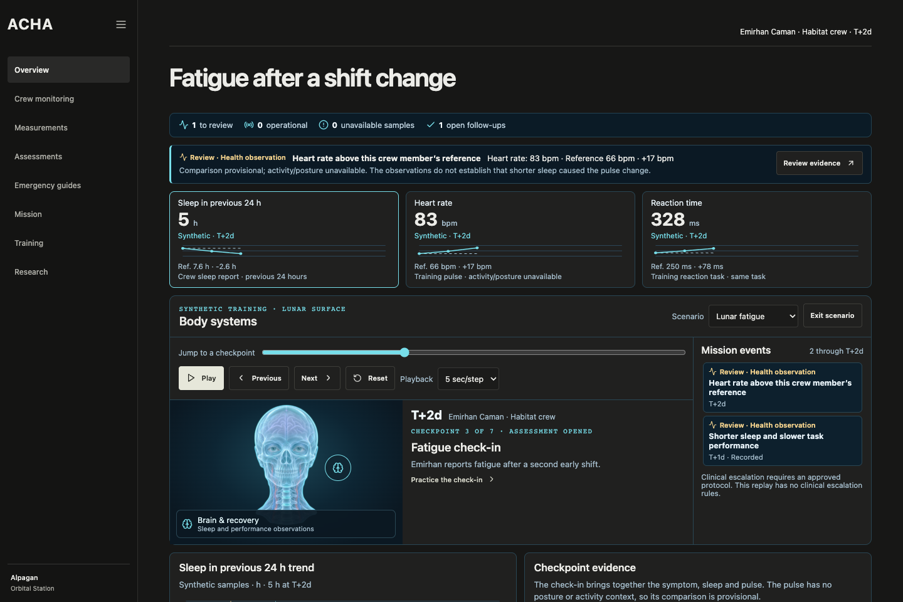

  

<h1 align="center">ACHA</h1>

  <strong>Autonomous Crew Health Assistant</strong> 
  Crew health check-ins for missions far from Earth.

  <a href="https://acha.tr/">Open the demo</a> ·
  <a href="https://acha.tr/?scenario=lunar-fatigue&amp;step=3">Replay Lunar Fatigue</a> ·
  <a href="docs/development.md">Run locally</a>

When communication with Earth is delayed, a crew needs to see what changed, review the evidence, and document what happened next. ACHA brings that sequence into one workspace. It was built for the **2026 NASA Space Apps Challenge** brief on astronaut health monitoring. The team’s Space Apps history includes a **2025 Local Event win for NovaCast**. [2026 challenge brief](https://www.spaceappschallenge.org/2026/challenges/health-monitoring-software/) · [NovaPulse team](https://www.spaceappschallenge.org/2025/find-a-team/novapulse/) · [Team announcement](https://tr.linkedin.com/company/stack-eleven)

## Try a crew check-in

Open the [Lunar Fatigue checkpoint](https://acha.tr/?scenario=lunar-fatigue&step=3). The fictional crew member’s heart rate is **83 bpm** against a **66 bpm** training reference. Activity and posture are missing, so the comparison is provisional.

1. Open the fictional check-in and advance to the resting repeat.
2. Record the **72 bpm** reading and link it to the original check-in.
3. Close the follow-up to document completion. The original reading and its repeat remain linked in this browser.

Use **Training** to replay **Orbital Pressure**, where cabin measurements drop out mid-event, or **Solar Relay Outage**, where a simulated handover waits for contact to return.

## Three ways to use ACHA

| Mode | What you can do |
| --- | --- |
| Connected workspace | Record measurements, review a crew member’s recent history, assess readings and symptoms, and link a follow-up. FastAPI evaluates the check-in and stores the inputs, result and rationale. |
| Browser training | Step through three scripted missions and practice a follow-up with fictional data. Replays work offline after the app shell is cached. Scenario comparisons are descriptive. |
| Standalone onboard demo | Run the Python assessment engine and SQLite on a local workstation. Practice a check-in and simulated ground handover without an internet connection. [Onboard quickstart](demo/START_HERE.md) |

Use **synthetic data only** in the shared public demo. ACHA is a research and training prototype for crew health workflows. Clinical use and flight operations require separate validation and authorization.

## Research and evidence

The Research workspace keeps historical archives and published datasets separate from crew records and training scenarios.

| Source | What ACHA shows |
| --- | --- |
| NASA OSDR | Historical ISS cabin temperature, humidity and CO₂ from **RR-6**, and fixed-instrument radiation dose rates from **RadLab DosTel1**. [Source registry](docs/health-monitoring.md#scientific-source-registry) |
| PhysioNet | Published **BIDMC** vital-sign replay, **Sleep-EDF** sleep-stage summaries and **QoL_Stress** cohort comparisons. [Data attribution](docs/competition-release.md#provenance-and-licensing) |
| Royal College of Physicians | The Python engine uses **NEWS2** as a terrestrial reference and preserves missing inputs in its results. [Rules and scope](demo/NEWS2_SOURCES.md) |

## Repository guide

| Path | Purpose |
| --- | --- |
| [`frontend/`](frontend) | React and TypeScript workspace, offline shell and training replays |
| [`backend/`](backend) | FastAPI service, PostgreSQL records and Alembic migrations |
| [`demo/`](demo) | Shared assessment engine and standalone SQLite app |
| [`docs/`](docs) | Local setup, scientific references and verification |
| [`scripts/`](scripts) | Browser checks, release checks and research data importers |

[Local development and tests](docs/development.md) · [Engine verification](demo/VALIDATION.md) · [Demo walkthrough](demo/SUBMISSION.md) · [Data and asset rights](docs/competition-release.md#provenance-and-licensing)
